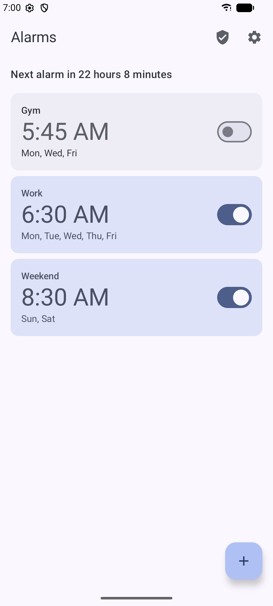
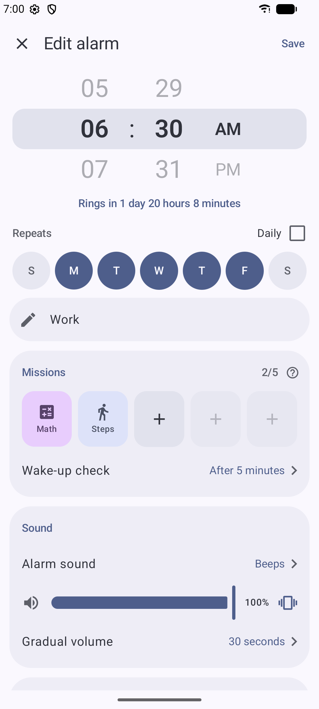
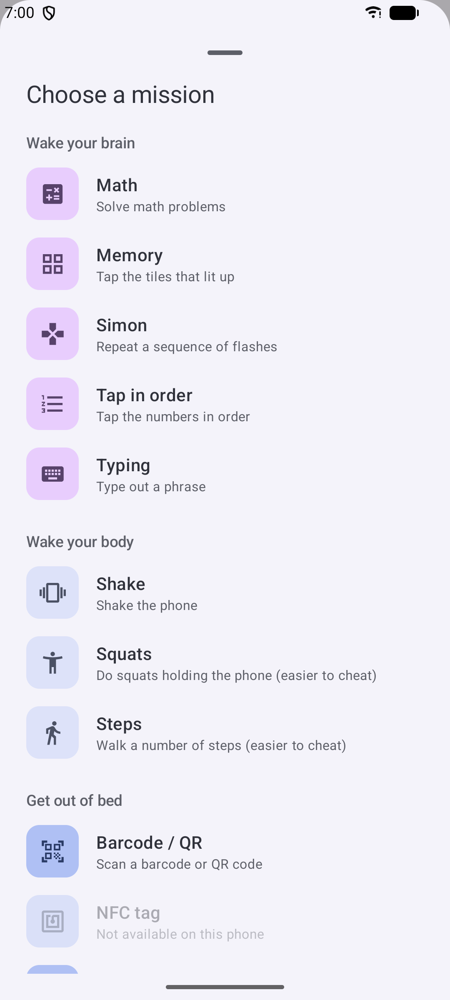
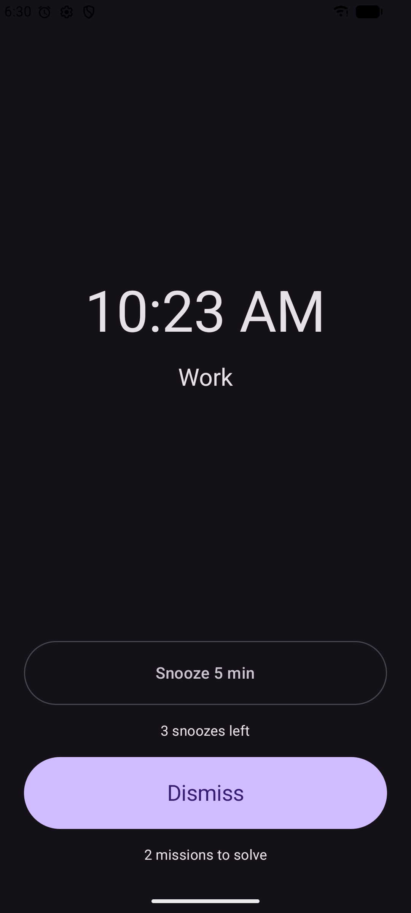
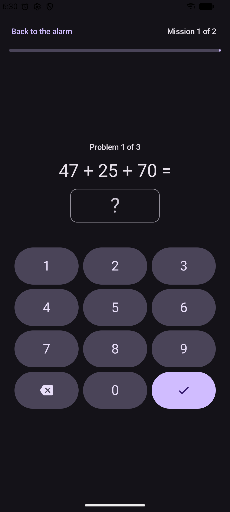

# Alarmist

An alarm clock that makes you get up. To turn it off, you first complete a mission: solve a few sums, walk a
number of steps, or scan the barcode on something in your bathroom. Free and open source, in the spirit of
Alarmy, without ads or tracking.

I built Alarmist for my own use, mostly so I wouldn't have to pay a subscription for an alarm clock. You're
welcome to try it, and I'd be glad to hear what you think.

## Features
**Alarms**
- One-off or repeating on chosen days, with a label. Skip the next ring of a repeating alarm without turning it off.
- Set the time with scroll wheels or a clock face (Settings).
- 14 built-in sounds, your own audio files, or the phone's ringtones; a backup sound if yours can't play.
- Volume per alarm, gradual volume, vibration, or vibration only.
- Snooze with a length and a limit. Auto-silence: rings a few minutes, goes quiet, tries again, and tells you if
  you missed it.
- Preview any alarm: it rings 10 seconds later, exactly as it will in the morning.

**Missions** (up to five per alarm, in your order; "Try it" in the editor)
- Brain: math (five difficulties), memory tiles, Simon, tap the numbers in order, type a phrase (or your own).
- Body: shake the phone, walk a number of steps, squats. These are easier to cheat, so pair them with one below.
- Get out of bed: scan a barcode or QR code you registered (say, your toothpaste), find the spot of a photo you
  took (say, the bathroom sink), or tap an NFC sticker.
- Opening a mission mutes the alarm for 30 seconds; stop or leave and it rings again.

**Making sure you're up**
- Wake-up check: a few minutes after you dismiss, it asks "Still awake?" and rings again if you don't answer.
- Optional anti-cheat: bring the alarm screen back if you leave it, lock the alarm volume, block the power menu
  while it rings (uses an accessibility service, only if you turn it on).

**Reliability**
- Uses Android's alarm clock API, which battery saving doesn't delay.
- Rings after a reboot, even before you unlock the phone, and keeps ringing if the app is killed.
- A reliability check walks you through the phone settings that can stop alarms, with tips for phone makers known
  for killing apps, and keeps a log of what rang, when, and what didn't.

**Everything else**
- Light and dark theme, Material You colours on Android 12+.
- Back up your alarms to a file and restore them on another phone.
- No internet permission, no ads, no tracking, no Google Play Services.

<details>
<summary><b>Screenshots</b></summary>
<br>
<p>





</p>
</details>

## Status
Early days. It has been tested on a small number of phones and on the Android emulator. Phones differ a lot in
how they treat alarms and sensors, so reports from other devices are very welcome.

An F-Droid submission is planned. Until then, download the APK from [Releases](../../releases) or build it
yourself (below).

## How it's made
Alarmist is built entirely by [Claude](https://claude.com/product/claude-code), Anthropic's AI model: it writes
all of the code. I'm not a Kotlin or Java programmer. I decide what the app should do, guide the work, review
the results and test every build on real phones. Commits carry a `Co-Authored-By: Claude` line.

If you spot code that looks odd, you're probably right. Please open an issue or a pull request.

## Help wanted
Use it, fork it, change it. All of these help:
- **Test it on your phone** and tell us how it went, good or bad: [docs/TESTING.md](docs/TESTING.md) lists what to
  try. The phone maker, model and Android version matter most for alarms.
- **Report bugs and ideas** in [Issues](../../issues).
- **Send pull requests:** fixes, new missions (they're plugins), translations, docs. See
  [CONTRIBUTING.md](CONTRIBUTING.md).

## Build
JDK 17 and an Android SDK (`local.properties` with `sdk.dir=…`, or `ANDROID_HOME`).

```bash
scripts/check.sh                    # build, unit tests, lint, format check (prints errors only)
./gradlew :app:installFdroidDebug   # install a debug build on a phone or emulator
scripts/release-check.sh            # the release build is reproducible and has no network permission
```

How the app works: [docs/ARCHITECTURE.md](docs/ARCHITECTURE.md). Each module also has a `README.md`.

## License
[GPL-3.0-or-later](LICENSE).
